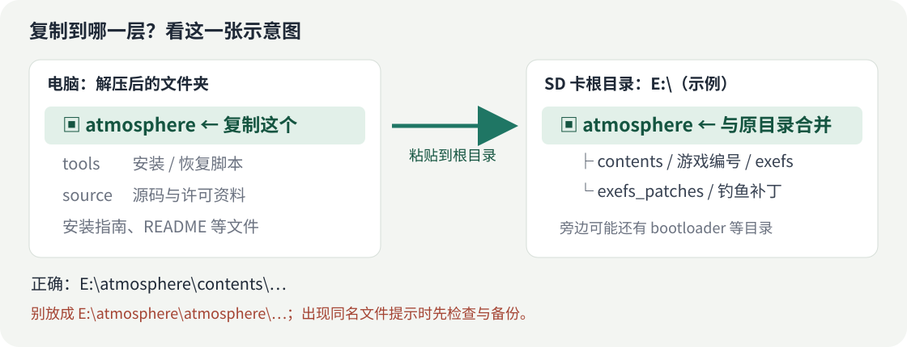

# 新手安装指南：Switch 星露谷物语 Mod

这个包提供跳过钓鱼小游戏、自动拿本竿随机宝箱，以及 UI 信息提示。
适用于运行大气层的 Switch《星露谷物语》**1.6.15.3 指定构建**，不绑定 SD 卡或读卡器。
**本包是预览版：UI 0.1.5 生日修复尚待真机复测，其他机型未逐一验证。**



## 先确认能否使用

游戏版本应为 **1.6.15.3**；Title ID 为 `0100E65002BB8000`；Build ID 前 16 位应为 `A5C617C14A7F3F66`。
前 16 位仅用于初步对照，完整编号见 [README](README.md#对应游戏)。同版本号不能代替完整构建核对。
如果有 EdiZon，可以在游戏运行时查看它显示的 Program ID 和 Build ID；完整核对也可使用自行导出的 ExeFS `main`。
游戏构建不符时不能直接用本包，改文件名也不能完成适配。

## 方法一：Windows 安装器（推荐，会备份同名文件）

### 第 1 步：关机、插卡、解压

完全退出游戏并关闭 Switch，再取出 SD 卡接到电脑。
把下载的 ZIP **完整解压到电脑上的文件夹**，不要直接在压缩包内运行脚本。
解压后应能看到 `atmosphere`、`tools`、`source` 和本指南。

### 第 2 步：找 SD 卡的盘符

打开“此电脑”，找到 SD 卡，例如 `E:`。
双击打开后，第一层就应该能看到原有的 `atmosphere` 文件夹；这一层就是“SD 卡根目录”。
下面命令里的 `E:` 只是例子，请换成自己的实际盘符。

### 第 3 步：在解压目录打开 PowerShell

回到刚刚解压的文件夹，**点击资源管理器上方显示文件夹路径的地址栏，输入 `powershell.exe`，按回车**。
打开的窗口应位于这个解压目录，而不是 SD 卡里。

先复制下面这一行，改好盘符，再粘贴到 PowerShell 并按回车：

```powershell
powershell -NoProfile -ExecutionPolicy Bypass -File .\tools\Install.ps1 -SdRoot "E:\" -CheckOnly
```

看到 `"status": "CHECK_ONLY"` 表示只读预检查通过，**此时还没有安装**。
如果有 `Game Build ID was NOT read...` 提示，意思是没有读取实际游戏 Build ID，不等于游戏构建已经核对通过；完整核对方法见 README。
如果报错并停止，先根据错误处理，不要跳过检查或直接覆盖未知 Mod。

### 第 4 步：正式安装

预检查通过、构建已确认后，运行下面这一行，同样改成实际盘符：

```powershell
powershell -NoProfile -ExecutionPolicy Bypass -File .\tools\Install.ps1 -SdRoot "E:\"
```

看到 `"status": "INSTALLED_AND_VERIFIED"` 表示文件已经复制并通过读回校验。
输出中的 `backup` 是备份位置，通常在电脑上解压目录的 `outputs/backups/` 里。**留着整个解压目录，不要删掉备份。**
安装器只备份本包涉及的同名文件，不备份当前游戏存档。需要保留游戏进度时，请另行导出存档。

### 第 5 步：插回 Switch

在电脑上安全弹出 SD 卡，插回关机状态的 Switch，再启动大气层和游戏。

## 方法二：手动复制（适合知道如何检查 Mod 冲突的人）

1. 先关机取卡，并备份本包将写入的三个同名文件；原来没有的文件也记下来。
2. 确认游戏构建一致，且没有其他 Mod 占用本包的原生模块、权限文件或修改相同代码。
3. 复制**解压目录里的 `atmosphere` 文件夹**，粘贴到 SD 卡根目录，合并文件夹。
4. 安全弹出，插卡开机。

正确：`E:/atmosphere/contents/...` 和 `E:/atmosphere/exefs_patches/...`。
放错一层：`E:/atmosphere/atmosphere/...`，或者 `E:/下载包名字/atmosphere/...`。

**遇到“替换文件”提示时，不要一律点“全部替换”。**
已确认是本包旧版本的同名文件，备份后才能升级；如果来自其他整合包或不知道来源，先用安装器检查或向发布者反馈。
不要删除整张卡的 `atmosphere` 文件夹。

## 如何确认生效

| 功能 | 在游戏里怎么试 |
| --- | --- |
| 钓鱼 | 正常抛竿、等待咬钩、提竿后，应直接进入收鱼流程，不再操作绿色条小游戏。 |
| 宝箱 | 等到原版随机生成宝箱的一竿，应随鱼一起捕获，之后正常开箱领物品。不是每一竿都有宝箱。 |
| UI 设置 | 进入存档，打开背包所在的游戏菜单，按住 **ZL＋ZR**，再按 **十字键↑**。 |

小锤子目前有手柄无法选中的已知问题，请用组合键。R3 是原版聊天功能，不是本 Mod 的设置键。

## 常见问题

- **脚本提示其他模块、NPDM 或同构建补丁冲突：**停止安装并核对已有 Mod，不要靠改文件名或强制覆盖解决。
- **游戏里没有变化：**检查实际 Build ID、文件是否放错一层，以及大气层是否正常启用了游戏覆盖。文件复制成功不代表游戏已经加载成功。
- **一直没有宝箱：**宝箱概率保持原版，只有这一竿原本生成宝箱才会自动捕获。
- **装后游戏报错：**完全退出游戏，使用备份恢复；反馈游戏版本、Build ID、报错和复现操作。UI 修复仍处于公开测试阶段。

## 怎么恢复旧版

在电脑上的解压目录打开 PowerShell，替换实际盘符和安装报告里的备份目录：

```powershell
powershell -NoProfile -ExecutionPolicy Bypass -File .\tools\Restore.ps1 -SdRoot "E:\" -BackupDirectory "实际备份目录" -CheckOnly
powershell -NoProfile -ExecutionPolicy Bypass -File .\tools\Restore.ps1 -SdRoot "E:\" -BackupDirectory "实际备份目录"
```

回退时会恢复旧文件，或移除本次新加的文件。安装后又被改动的文件会被保护，脚本不会盲目覆盖。
手动安装则恢复自己的同名备份；原来没有的文件，仅移除本包新加的文件。
只改 IPS 外层文件夹名字不能关闭补丁。详细文件列表和分组件操作见 [README](README.md)。

## 发布者可直接复制这段介绍

> Switch《星露谷物语》1.6.15.3 便携 Mod 预览包，包含跳过钓鱼小游戏、原版概率自动拿宝箱和 UI 信息套件。需大气层环境及指定游戏 Build ID，不绑定 SD 卡或读卡器。下载完整包后先打开《先看这里-安装指南.html》，Windows 用户按指南用安装器备份并安装。UI 设置：游戏内背包菜单，ZL＋ZR＋十字键↑。UI 0.1.5 修复尚待真机复测，其他机型未逐一验证；请保留完整源码、GPL 许可证和预览版说明转载。
